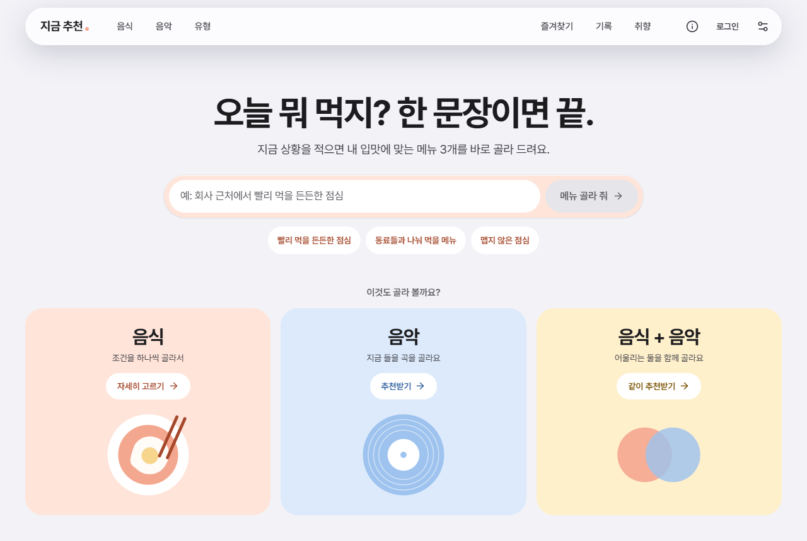
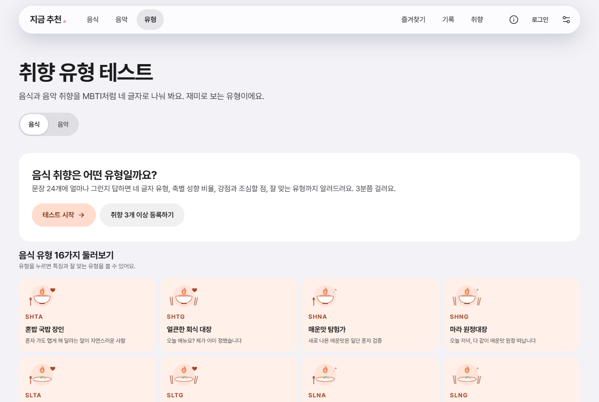
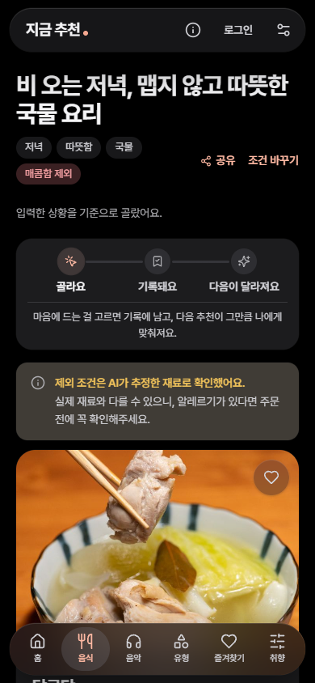
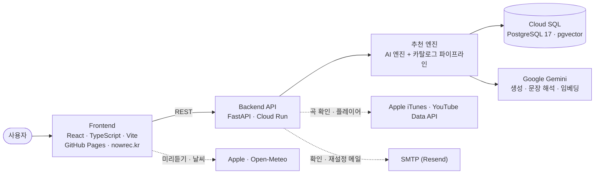

<div align="center">

# 🍜🎧 지금 추천

**지금 상황을 한 문장으로 적으면, 어울리는 음식과 음악을 골라 줍니다.**

평소 취향과 이번 요청의 조건을 나눠 읽고, 추천 이유와 함께 메뉴 3개·곡 5곡을 보여 주는 웹 서비스입니다. → [nowrec.kr](https://nowrec.kr)

[](https://github.com/Ow-wL/NowRecommend/actions/workflows/frontend-ci.yml) [](https://github.com/Ow-wL/NowRecommend/actions/workflows/server-ci.yml) [](https://github.com/Ow-wL/NowRecommend/actions/workflows/deploy-pages.yml)

       


</div>

> [!IMPORTANT]
> **추천은 사실이 아니라 제안입니다.** 등록된 목록과 AI(Google Gemini)의 판단으로 만들며, AI는 실제로 없는 메뉴나 곡을 말하거나 사실과 다른 설명을 할 수 있습니다. 재료와 제외 조건은 등록 정보와 AI가 추정한 재료 기준이라 실제 판매처와 다를 수 있습니다. **알레르기 안전을 보장하지 않으므로** 주문 전에 판매처에 직접 확인해야 하고, 추천은 의학·영양 상담이 아닙니다. 알레르기·질환 같은 건강 표현은 따로 동의를 받은 뒤에만 기록하거나 보냅니다. 이용은 만 18세 이상입니다(Gemini API 약관). 약관과 처리방침은 사이트의 `#/terms`·`#/privacy`(내용은 [`src/legal.ts`](src/legal.ts))에 있고, 법률 검토를 거친 문서가 아닙니다.

## 목차

[역할](#-역할) · [화면](#-화면) · [주요 기능](#-주요-기능) · [구조](#%EF%B8%8F-구조) · [빠른 시작](#-빠른-시작) · [검증](#-검증) · [배포](#-배포) · [데이터·외부 서비스 출처](#%EF%B8%8F-데이터외부-서비스-출처) · [문서](#-문서)

## 👤 역할

| 담당 | 범위 |
|---|---|
| 이주형 ([@Ow-wL](https://github.com/Ow-wL)) | 전부 — 기획, 프런트엔드, 추천 API와 DB, AI 연동, 카탈로그 검수, 약관·처리방침 초안, 테스트와 CI, GCP 배포와 운영, 문서 |

개발은 Claude Code를 사용하는 하네스 엔지니어링 방식으로 진행했습니다. 단계마다 계획 문서([plans.md](plans.md), [plans-rag.md](plans-rag.md), [plans-music-ai.md](plans-music-ai.md))를 먼저 쓰고, 테스트와 배포 기록([DEPLOY.md](DEPLOY.md))으로 완료를 확인했습니다. 설계 결정, 보안, 되돌리기 어려운 변경 같은 중요한 작업은 Codex(GPT)에게도 교차 검토를 받았습니다.

## 📸 화면

<table>
  <tr>
    <td width="50%" align="center"><br><sub><b>홈</b> — 한 문장으로 바로 추천받거나, 음식·음악·같이 추천으로 들어갑니다</sub></td>
    <td width="50%" align="center"><br><sub><b>취향 유형</b> — 24문장에 답하면 네 글자 유형, 16가지 도감</sub></td>
  </tr>
  <tr>
    <td colspan="2" align="center"><br><sub><b>모바일·다크 모드</b> — 하단 탭 메뉴</sub></td>
  </tr>
</table>

<sub>운영 사이트 nowrec.kr에서 로그인하지 않은 상태로 찍었습니다(2026-11-29). 위 추천 결과는 그때 AI가 고른 것이라 같은 문장이어도 다시 받으면 달라질 수 있습니다. 음식 사진은 Unsplash·Pexels·Wikimedia Commons(사진별 출처는 앱의 사진 정보).</sub>

## ✨ 주요 기능

| | 기능 | 내용 |
|---|---|---|
| 🍜 | **한 문장 음식 추천** | 상황 문장에서 조건(시간대·맛·제외 재료 등)을 찾아 칩으로 보여 주고, 메뉴 3개를 이유와 함께 고릅니다. 지원하지 않는 조건(가격·배달·위치)은 바꾸지 않고 알립니다 |
| 🎧 | **음악 추천** | AI가 상황과 취향에 맞는 5곡을 고르고, Apple 스토어에서 실제로 있는 곡을 확인해 먼저 보여 줍니다. 발매 연도, 비슷한 곡 요청 |
| 🍱 | **같이 추천** | 음식에 어울리는 곡을 짝지어 줍니다. 모델 없이 태그 규칙으로 고르므로 이유를 확인할 수 있습니다 |
| 🧩 | **취향 유형** | 음식·음악 각각 24문장(5점 척도)으로 네 글자 유형(16가지)과 축별 비율. 친구에게 링크를 보내 궁합 보기, 공유 카드, 유형으로 추천받기 |
| ❤️ | **즐겨찾기·기록** | 저장한 후보 안에서 추천, 고정·한 장 교체·최대 3개 비교, 선택 기록과 만족도·메모, 검색·달력, 직접 기록, 이번 달 요약 |
| 🔊 | **듣기** | 30초 Apple 미리듣기, 곡 상세의 Apple Music 플레이어와 YouTube 플레이어, 다른 음악 앱 검색 링크 |
| 👤 | **계정과 동기화** | 로그인 없이(게스트) 쓸 수 있고, 가입하면 취향·기록을 기기 간에 합쳐서 맞춥니다. 가입 이메일 확인, 비밀번호 재설정 메일, 모든 기기 로그아웃 |
| 🛡️ | **안전장치** | 만 18세 확인, 건강 표현 별도 동의, AI 하루 한도(넘으면 등록 목록으로 추천), 의견 보내기·오류 신고 |
| 🗂️ | **관리 콘솔** | 관리자 계정에만 보이는 `#/admin` — 개요, 이용 통계, 문의함, 회원(정지), 콘텐츠(숨김), 추천·AI, 접속 기록, 운영 상태, 조치 기록의 9구역 |
| 🌗 | **편의** | 라이트·다크·시스템 테마와 강조색, 지금 날씨 반영, 말로 입력, 공유, 백업·가져오기, 홈 화면 설치와 오프라인 동작(서비스 워커) |

> 서버 주소(`VITE_API_BASE_URL`) 없이 빌드하면 내장 카탈로그와 브라우저 규칙만 쓰는 오프라인 모드로 동작합니다. 이때는 계정·AI·관리 콘솔이 없습니다.

## 🏗️ 구조



- **AI가 실패해도 답이 나갑니다.** 모델 오류·시간 초과·한도 초과면 유사도 검색 결과(카탈로그 파이프라인)와 템플릿 이유로 대신 답하고, 화면에 "기본 방식으로 추천했어요"를 표시합니다.
- **필수 제외는 AI에 맡기지 않습니다.** 등록 재료는 SQL로 거르고, AI가 이름 붙인 메뉴는 AI가 추정한 재료로 다시 확인해 "AI 추정"으로 표시합니다.
- **조건 어휘는 한 파일에서 나옵니다.** 태그·제외 어휘(`shared/vocab.json`)와 해석·필터 사례(`shared/*-cases.json`)를 프런트와 서버가 함께 읽고 함께 검사합니다.
- **API는 인스턴스 하나로 띄웁니다.** 분당 제한과 캐시가 메모리에 있고, 하루 한도는 DB(`usage_daily`)에 둡니다.

<details>
<summary><b>저장소 구성</b></summary>

```text
src/              React 앱: 화면(components/), 관리 콘솔(components/admin/), 서버 요청(api/), 추천·해석 규칙(domain.ts)
public/           아이콘, manifest, 서비스 워커(sw.js), 자체 호스팅 음식 사진, 지난 판 약관(legal/)
shared/           프런트와 서버가 같이 읽는 어휘(vocab.json), 해석·필터 사례, 약관 버전(legal.json)
server/
  app/            FastAPI: routes/, 추천(recommend.py, ai_engine.py), 인증, 한도(budget.py), 메일, llm/
  app/cli/        seed · embed · draft · review · eval · eval_ai · admin · migrate · media
  alembic/        DB 마이그레이션 0001~0014
  data/           시드 카탈로그(seed_items.json)와 검수 항목(reviewed_items.json)
  eval/           평가 세트와 보고서
  tests/          pytest
tests/            Playwright: 오프라인(tests/*.spec.ts), 서버 모드(api/), 빌드 결과물(built/)
scripts/          카탈로그 내보내기, 아이콘·OG·사진 사본 만들기, 약관 스냅숏
docs/             README 이미지, 자세한 기록(DETAILS.md)
```

</details>

## 🚀 빠른 시작

**필요한 것:** Node.js 22 · Microsoft Edge(브라우저 테스트) · 서버 모드는 Docker Desktop과 Gemini API 키

**오프라인 모드** (서버 없이, 내장 카탈로그)

```powershell
npm install
```
```powershell
npm run dev                      # http://127.0.0.1:5173
```

**서버 모드** (PostgreSQL 17 + pgvector와 FastAPI를 컨테이너로)

루트 `.env`에 `GEMINI_API_KEY`를 넣습니다. API 컨테이너는 시작할 때 Alembic 마이그레이션을 적용합니다.

```powershell
docker compose up -d --build     # DB 127.0.0.1:5433, API 127.0.0.1:8010
```
```powershell
docker compose exec api python -m app.cli.seed     # 카탈로그 넣기 (바뀐 항목만)
```
```powershell
docker compose exec api python -m app.cli.embed    # 문장 임베딩 계산 (바뀐 항목만)
```
```powershell
$env:VITE_API_BASE_URL = 'http://127.0.0.1:8010'; npm run dev
```

API의 CORS 허용 주소가 `127.0.0.1:5173`·`localhost:5173`이라, 포트를 바꾸면 `CORS_ORIGINS`도 바꿉니다. 포트가 겹치면 `DB_PORT`·`API_PORT`로 옮깁니다.

<details>
<summary><b>환경변수</b> (값은 커밋하지 않습니다)</summary>

| 위치 | 키 | 용도 |
|---|---|---|
| 빌드 (`VITE_*`) | `VITE_API_BASE_URL` | 서버 모드. 없으면 오프라인 모드 |
| | `VITE_PUBLIC_URL`, `VITE_RELEASE` | 링크 미리보기 주소, 빌드 이름(오류 기록·오프라인 캐시 이름) |
| | `VITE_OPERATOR_NAME`, `VITE_CONTACT_EMAIL` | 약관·처리방침의 운영자와 문의 주소 |
| | `VITE_WEATHER`, `VITE_OPEN_METEO_KEY` | `off`면 날씨 버튼을 끔, 유료 Open-Meteo 키 |
| | `VITE_APPLE_PREVIEWS`, `VITE_APPLE_EMBED`, `VITE_YOUTUBE_EMBED` | `off`면 미리듣기·Apple Music 플레이어·YouTube 플레이어를 끔 |
| 서버 | `DATABASE_URL` | 기본은 로컬 `127.0.0.1:5433` |
| | `GEMINI_API_KEY` | 생성·해석·임베딩. 없으면 AI 없이 동작 |
| | `LLM_MODEL`, `MUSIC_ENGINE`, `FOOD_ENGINE` | 모델(코드 기본 `gemini-3.6-flash`, 운영 `gemini-3.5-flash-lite`), 엔진 `ai`·`catalog` |
| | `AUTH_SECRET` | 계정 기능. 없으면 계정 경로가 503이고 게스트 전용 |
| | `SMTP_HOST`, `SMTP_PORT`, `SMTP_USER`, `SMTP_PASSWORD`, `MAIL_FROM`, `PUBLIC_APP_URL` | 확인·재설정 메일과 메일 속 링크 주소 |
| | `EMAIL_VERIFICATION` | 가입 이메일 확인(코드 기본 false, 운영 true) |
| | `YOUTUBE_API_KEY` | YouTube 플레이어용 영상 검색. 없으면 플레이어를 내지 않음 |
| | `AI_DAILY_LIMIT`, `AI_DAILY_PER_MEMBER`, `AI_DAILY_PER_GUEST` | 하루 AI 한도(기본 3000 · 100 · 40, 0은 끔) |
| | `CORS_ORIGINS`, `TRUST_PROXY`, `ADMIN_OWNER_ID`, `API_DOCS` | 허용 출처, 프록시 뒤 IP 읽기, 관리자 지정 권한 계정, `/docs` 켜기 |

전체 목록과 기본값은 [`server/app/config.py`](server/app/config.py)에, 빌드 변수의 실제 값은 [`.github/workflows/deploy-pages.yml`](.github/workflows/deploy-pages.yml)이 저장소 Actions 변수에서 읽습니다.

</details>

관리자 지정, 카탈로그 늘리기(AI 초안 → 사람 검수), 평가 도구는 [docs/DETAILS.md](docs/DETAILS.md)에 있습니다.

## ✅ 검증

```powershell
npm test                         # 단위 테스트 (Vitest)
```
```powershell
npm run test:e2e                 # 브라우저 테스트: 오프라인 + 가짜 API 서버 모드 (Playwright, Edge)
```
```powershell
npm run build                    # 타입 검사와 빌드
```
```powershell
npm run test:dist                # 빌드 결과물: 보안 정책(CSP), 아이콘, 오프라인 캐시
```
```powershell
cd server; .venv\Scripts\python -m pytest     # 서버 (Python 3.12+, DB 테스트는 NOWREC_DB_TESTS=1)
```

| 지켜지는 것 | 방법 |
|---|---|
| 프런트와 서버의 조건 해석이 같은지 | `shared/parse-cases.json`, `shared/filter-cases.json`을 양쪽 테스트가 함께 읽음 |
| 내장 카탈로그와 서버 시드가 같은지 | `src/data.ts`와 `server/data/seed_items.json`이 어긋나면 `npm test` 실패 |
| 실제 서버·Gemini를 부르지 않는지 | 브라우저 테스트는 가짜 API 주소로 요청을 가로채고, 서버 테스트는 가짜 임베더·모델 |
| DB 스키마가 모델과 맞는지 | CI에서 pgvector 컨테이너에 `alembic upgrade head`와 `alembic check` |
| AI 추천 품질이 나빠지지 않았는지 | `python -m app.cli.eval_ai check NAME --against ai-r1` (48개 상황, Gemini 비용 발생) |

`frontend-ci.yml`은 모든 브랜치와 PR에서 돌고, `main`의 필수 검사입니다(2026-11-17부터 브랜치 보호). CI는 Playwright의 Chromium을, 개발 PC는 Edge를 씁니다. `server-ci.yml`은 `server/`·`shared/`가 바뀔 때 돕니다.

아직 확인하지 못한 것은 실사용자 과제 수행, 실제 모바일 키보드, 스크린리더입니다.

## 📦 배포

| 부분 | 어디에 | 어떻게 |
|---|---|---|
| 화면 | GitHub Pages, 도메인 `nowrec.kr` | `main`에 push하면 `deploy-pages.yml`이 테스트·빌드·배포. `main`은 PR로만 받습니다 |
| API | Cloud Run `nowrecommend-api` (서울 리전, 인스턴스 0~1개) | 이미지를 만들어 Artifact Registry에 올린 뒤 `gcloud run deploy` |
| DB | Cloud SQL PostgreSQL 17 + pgvector | 컨테이너가 시작할 때 확장 마이그레이션을 적용. 자동 백업 7개 |
| 카탈로그 | Cloud Run 작업 `nowrecommend-seed` | 시드와 임베딩을 바뀐 항목만 갱신 |

```powershell
docker build -f server/Dockerfile -t nowrecommend-api .     # 프로젝트 루트에서 (shared/와 server/만 들어감)
```

API는 새 리비전으로 배포하고, 문제가 있으면 트래픽을 직전 리비전으로 되돌립니다. DB 마이그레이션이 바뀐 배포는 되돌리기 전에 downgrade가 필요할 수 있습니다. 리비전별 운영 기록, 되돌리기, 모니터링·알림, 비용은 [DEPLOY.md](DEPLOY.md)에 있습니다.

## 🗂️ 데이터·외부 서비스 출처

| 쓰이는 곳 | 출처 |
|---|---|
| 추천 생성, 문장 해석, 문장 임베딩 | Google Gemini API (운영 `gemini-3.5-flash-lite`, 임베딩 `gemini-embedding-2`) |
| 카탈로그 | 음식 81개·음악 226곡. 기본 시드에 AI 초안을 사람이 검수해 더함(`server/data/`) |
| 곡 확인, 앨범 커버, 30초 미리듣기, Apple Music 플레이어 | Apple iTunes Search API · Apple Music 임베드 |
| 곡 상세의 YouTube 플레이어 | YouTube Data API · YouTube 임베드 플레이어 |
| 지금 날씨 반영 | Open-Meteo (CC BY 4.0, 화면에 출처 표기) |
| 음식 사진 | Unsplash, Pexels (자체 호스팅), 일부 Wikimedia Commons |
| 확인·재설정 메일 | Resend (SMTP) |
| 글꼴 | Pretendard (OFL) |

각 서비스의 이용 조건(상업 이용, 표기, 보관 기간, 하루 한도)과 끄는 스위치는 [docs/DETAILS.md의 외부 서비스 이용 조건](docs/DETAILS.md#외부-서비스-이용-조건-2026-11-17-확인)에 있습니다.

## 📚 문서

| 문서 | 내용 |
|---|---|
| [docs/DETAILS.md](docs/DETAILS.md) | 옛 README의 자세한 기록: 두 가지 모드, 추천 파이프라인, 계정과 동기화, 약관과 동의, 외부 서비스 조건, 비용 한도, 카탈로그 늘리기, 입력 해석, 저장 범위 |
| [DEPLOY.md](DEPLOY.md) | GCP 구성, 배포·되돌리기, 운영 기록, 모니터링과 비용 |
| [DESIGN.md](DESIGN.md) | 디자인 시스템(v9) |
| [erd.md](erd.md) | 데이터베이스 구조의 초기 설계(이후 표는 `server/alembic/versions/`의 마이그레이션 0001~0014) |
| [plans.md](plans.md) · [IMPLEMENTATION.md](IMPLEMENTATION.md) · [EXTENSIONS.md](EXTENSIONS.md) · [VERIFICATION.md](VERIFICATION.md) | 브라우저 앱 계획과 2026-10-13 시점의 구현·검증 기록 |
| [plans-rag.md](plans-rag.md) | DB·유사도 검색·AI 재순위 계획(R0~R7) |
| [plans-music-ai.md](plans-music-ai.md) | 음악 AI 추천 방식 비교 실험 |
| [server/eval/ai_report.md](server/eval/ai_report.md) | AI 엔진 평가 결과 |
