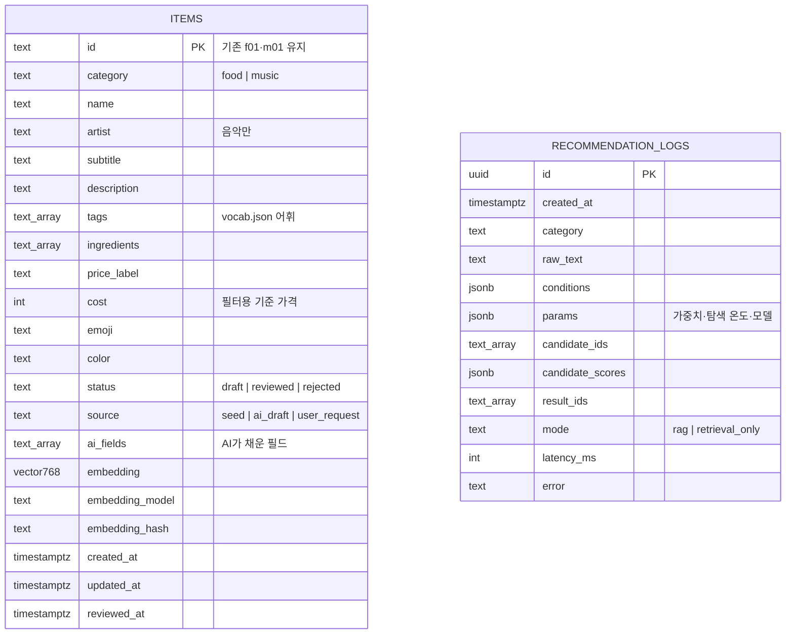
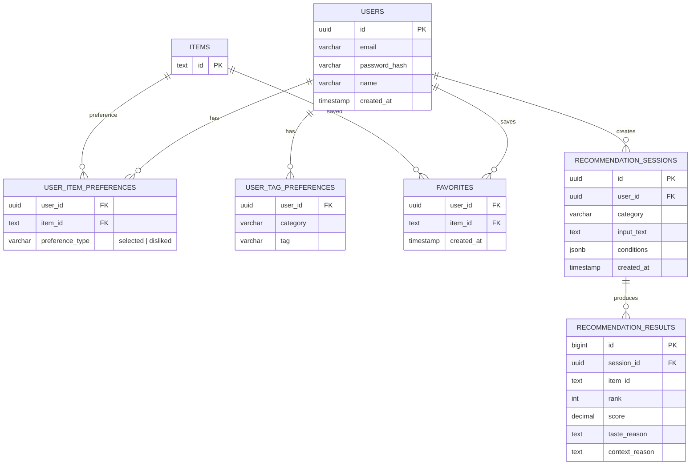

# 지금 추천 — ERD

## 현재 구현 (plans-rag.md R1)

음식·음악을 통합 `ITEMS` 테이블에 저장합니다. 태그는 별도 테이블 대신 `shared/vocab.json` 어휘로 검증한 `text[]`로 둡니다. 실제 정의는 `server/alembic/versions/0001_items_and_logs.py`에 있습니다.

- `RECOMMENDATION_LOGS`의 ID 배열은 `ITEMS.id`를 가리키지만, 항목이 바뀌거나 내려가도 로그가 남도록 외래 키를 두지 않습니다.
- 고유 인덱스 `(category, lower(name), coalesce(lower(artist), ''))`로 같은 메뉴·곡의 중복 등록을 막습니다.

## 후속 단계 — 계정 도입 시 (plans-rag.md §12 결정 1)

현재 취향·즐겨찾기·기록은 브라우저 저장소에 있습니다. 계정을 도입하면 아래 테이블을 추가하고 모두 `ITEMS`를 참조합니다.

