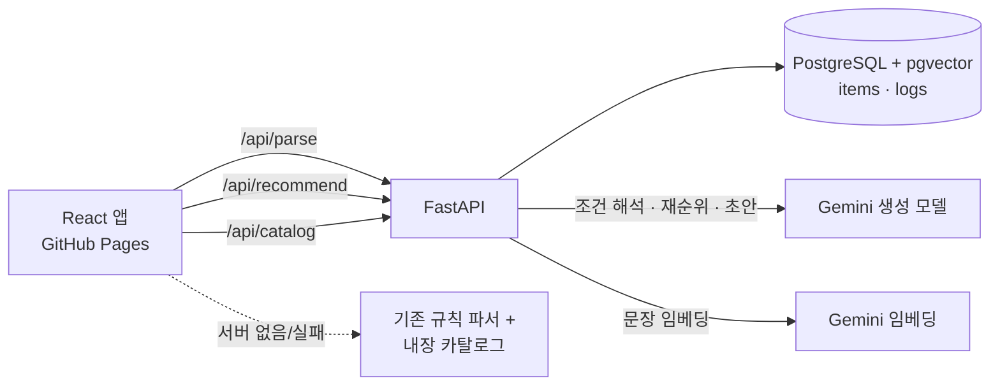

# 지금 추천 — DB·유사도 검색·AI 재순위 구현 계획

작성일: 2026-10-19 · 상태: **R0~R7 완료, 공개 배포 완료(2026-10-19, Cloud Run + Cloud SQL, [DEPLOY.md](./DEPLOY.md))** — 남은 일은 §11 끝의 "R7 이후" 참고 · 결정: B 방식(유사도 검색으로 후보를 뽑고, AI는 그 후보 안에서만 고르고 설명)

이 문서는 이전 주의 [plans.md](./plans.md)(P0·P1·P2, 정적 사이트)에 이어지는 서버·DB·AI 단계의 실행 계획이다. 화면 규칙과 디자인 기준은 계속 plans.md와 [DESIGN.md](./DESIGN.md)를 따른다.

## 1. 목표와 원칙

**사용자가 문장으로 상황을 말하면, DB에 있는 검수된 메뉴·곡 중에서 상황·취향과 가장 가까운 후보를 벡터 유사도로 찾고, AI가 그 안에서 골라 이유를 설명한다.**

지켜야 할 원칙:

- **AI는 후보 목록 밖의 항목을 추천하지 않는다.** 응답의 항목 ID를 서버가 검증한다. (상위 기획서 §8)
- **필수 제외·예산·장기 비선호는 SQL에서 처리한다.** AI 판단에 맡기지 않으며 자동으로 완화하지 않는다.
- **AI가 실패해도 추천이 된다.** 조건 해석 실패 → 기존 규칙 파서, 재순위 실패 → 유사도 순위 + 기본 설명, 서버 없음 → 현재의 브라우저 단독 모드.
- **검수 완료(`reviewed`) 항목만 추천한다.** AI가 만든 초안 데이터는 검수 전까지 후보가 되지 않는다.
- 기존 규칙 유지: 장기 취향과 이번 요청 조건 분리, 음식 3개·음악 5곡, 부족하면 실제 개수만 표시, 선택·즐겨찾기·만족도를 취향에 자동 반영하지 않음.

이번 계획 범위 밖: 로그인과 사용자 데이터의 서버 이전(§12 결정 1), 실시간 가격·지도·주문, 음원 재생.

## 2. 전체 구조



추천 1회의 흐름:

1. **조건 해석**: 문장 → LLM 구조화 출력(허용 태그 목록 안에서만) + 규칙 파서 결과를 합침 → 사용자가 확인·수정.
2. **필수 필터(SQL)**: 분야, `status='reviewed'`, 재료·태그 제외, 예산, 장기 비선호, 이번 요청 제외, 즐겨찾기 범위.
3. **유사도 점수**: 상황 벡터 유사도 + 취향 벡터 유사도 + 태그 일치 − 이미 본 후보 감점.
4. **후보 선택**: 탐색 온도 τ로 약간 흔든 뒤 MMR로 서로 다른 후보 10~15개 선택.
5. **AI 재순위**: 후보의 특징 + 상황 + 취향 요약을 묶어 질문 → 3개/5곡과 이유 2종 반환.
6. **검증**: ID·개수·중복·제외 위반 검사, 부족분은 유사도 순위로 채움 → 응답 + 로그 기록.

## 3. 기술 선택

| 영역 | 선택 | 이유 |
|---|---|---|
| 서버 | Python 3.12 · FastAPI · Pydantic v2 | 상위 기획서의 계획 스택. 개발 PC에 Python 3.12·Docker 설치되어 있음 |
| DB | PostgreSQL 17 + pgvector (`pgvector/pgvector:pg17` Docker 이미지) | 필터와 유사도 계산을 한 쿼리로 처리. 별도 벡터 DB 운영 불필요 |
| DB 접근 | SQLAlchemy 2 · psycopg 3 · `pgvector` 파이썬 패키지 · Alembic | 마이그레이션 이력 관리 |
| 임베딩 | `gemini-embedding-2`, 768차원 | 안정 버전. 768차원은 자동 재정규화됨. `task_type` 대신 문장 접두어로 작업 지정 ([Embeddings 문서](https://ai.google.dev/gemini-api/docs/embeddings)). R1 확인: 문자열 목록을 그대로 보내면 **하나의 임베딩으로 합쳐지므로** 문장마다 별도 `Content`로 보내고 개수를 검사함 |
| 생성 모델 | `gemini-3.6-flash` (환경 변수로 교체 가능), 구조화 출력 | 안정 Flash 모델, JSON 스키마 출력 지원 ([모델 문서](https://ai.google.dev/gemini-api/docs/models/gemini-3.6-flash)) |
| SDK | `google-genai` | 공식 파이썬 SDK. 호출부는 `llm/client.py` 한 곳에 모아 API 형태 변경에 대비 |
| 테스트 | pytest · 가짜 LLM 어댑터 · Docker 테스트 DB | AI 없이도 전 경로 테스트 |

### temperature 처리 — 중요

Gemini 3.6 Flash부터 `temperature`·`top_p`·`top_k`는 **무시되며 이후 세대에서는 오류**가 된다고 공지되어 있다 ([3.6 변경 사항](https://ai.google.dev/gemini-api/docs/whats-new-gemini-3.6)). 그래서 temperature를 두 가지로 나눠 설계한다.

- **AI 출력의 안정성**: temperature 대신 시스템 지시문의 명시 규칙 + 구조화 출력 스키마 + 서버 검증으로 확보한다.
- **추천 다양성 = 직접 구현하는 "탐색 온도" τ**: 후보 점수에 `τ × Gumbel 노이즈`를 더해 뽑는다. τ=0이면 항상 같은 결과(평가·재현용), τ가 클수록 다양해진다. 모델과 무관하게 동작하고 값을 실험·보고할 수 있다.

temperature를 반드시 모델 파라미터로 다뤄야 한다면 `gemini-2.5-flash`(temperature 지원)로 바꾸는 선택지가 있다(§12 결정 3).

## 4. 폴더 구성

```
harness-nowrecommend/
  docker-compose.yml          # db(pgvector) + api
  shared/vocab.json           # 태그·제외 재료·장르 어휘 — 프론트·서버 공통 단일 기준
  server/
    pyproject.toml  alembic/  .env.example
    app/
      main.py  config.py  db.py  models.py  schemas.py
      routes/      catalog.py  parse.py  recommend.py  health.py
      retrieval/   filters.py  scoring.py  select.py (τ 샘플링 + MMR)
      llm/         client.py  prompts.py  parse.py  rerank.py  draft.py  validate.py
      embeddings.py            # 문서/질의 텍스트 템플릿, 캐시
      cli/         seed.py  draft.py  review.py  embed.py  eval.py
    data/seed_items.json      # 현재 data.ts 31개 항목 변환본
    eval/cases.json           # 평가용 상황 문장
    tests/
  scripts/export-catalog.ts   # data.ts → seed_items.json (vite-node로 1회 실행)
  src/api/client.ts           # 서버 호출·타임아웃·오류 형식
  src/catalog.ts              # 카탈로그 로드(API → 실패 시 내장 data.ts)
```

## 5. 데이터베이스

```sql
CREATE EXTENSION IF NOT EXISTS vector;

CREATE TABLE items (
  id              text PRIMARY KEY,          -- 기존 f01·m01 유지(브라우저 저장 데이터 호환), 신규는 f-xxxxxxxx
  category        text NOT NULL CHECK (category IN ('food','music')),
  name            text NOT NULL,
  artist          text,                      -- 음악만
  subtitle        text NOT NULL,             -- 음식: 가격 범위, 음악: 아티스트 (현재 Item 형식 유지)
  description     text NOT NULL,
  tags            text[] NOT NULL,           -- shared/vocab.json 어휘만 허용
  ingredients     text[] NOT NULL DEFAULT '{}',
  price_label     text,
  cost            integer CHECK (cost > 0),  -- 필터용 기준 가격
  emoji           text NOT NULL,
  color           text NOT NULL,
  status          text NOT NULL DEFAULT 'draft' CHECK (status IN ('draft','reviewed','rejected')),
  source          text NOT NULL CHECK (source IN ('seed','ai_draft','user_request')),
  ai_fields       text[] NOT NULL DEFAULT '{}', -- AI가 채운 필드 → 검수 화면에 표시
  embedding       vector(768),
  embedding_model text,
  embedding_hash  text,                      -- 임베딩 원문 해시. 내용이 바뀌면 재계산
  created_at timestamptz DEFAULT now(), updated_at timestamptz DEFAULT now(), reviewed_at timestamptz
);
CREATE UNIQUE INDEX items_unique_name ON items (category, lower(name), coalesce(lower(artist), ''));
CREATE INDEX items_ingredients ON items USING gin (ingredients);
CREATE INDEX items_tags ON items USING gin (tags);

CREATE TABLE recommendation_logs (
  id uuid PRIMARY KEY, created_at timestamptz DEFAULT now(),
  category text, raw_text text, conditions jsonb, params jsonb,       -- 가중치·τ·모델명
  candidate_ids text[], candidate_scores jsonb, result_ids text[],
  mode text CHECK (mode IN ('rag','retrieval_only')), latency_ms integer, error text
);
```

- 목표 규모(음식 약 100개, 음악 약 200곡)에서는 전체 비교가 충분히 빠르므로 HNSW 인덱스는 만들지 않는다. 1만 건 이상이 되면 추가한다.
- 사용자 테이블은 이번 범위에서 만들지 않는다. 취향·기록은 지금처럼 브라우저에 두고 요청마다 필요한 값만 보낸다(서버 무상태).
- [erd.md](./erd.md)는 R1에서 `FOOD_ITEMS`·`MUSIC_TRACKS`·`TAGS`를 통합 `ITEMS`로 갱신하고, 사용자 관련 테이블은 "후속 단계"로 표시한다.

## 6. 추천 파이프라인 상세

### 6.1 API

`POST /api/recommend`

```jsonc
// 요청
{ "category": "food", "raw": "혼자 먹을 담백한 저녁, 만원 이하",
  "conditions": { "tags": ["혼자","저녁","담백함"], "excluded": ["밀"], "maxPrice": 10000 },
  "profile": { "selected": ["f01","f02","f07","f09","f12"], "tags": ["담백함"], "disliked": ["f08"] },
  "excludedIds": [], "seenIds": ["f02"], "pinnedIds": [], "candidateIds": null, "count": 3 }
// 응답
{ "results": [ { "item": { /* 현재 Item 형식 그대로 */ }, "tasteReason": "...", "contextReason": "..." } ],
  "meta": { "mode": "rag", "eligibleCount": 7, "newCount": 3, "catalogVersion": "2026-10-20-db-1", "requestId": "..." } }
```

- 응답의 `item`은 현재 `validRecommendation` 형식(이름·부제·설명·이모지·색·태그·재료·가격)을 그대로 따른다 → 기록 스냅샷·sessionStorage 검증을 바꾸지 않아도 된다.
- 한 장 교체는 같은 API에 `count: 1`과 현재 표시 ID를 `excludedIds`에 더해 호출한다.
- `GET /api/catalog?category=food` — 검수 완료 항목(임베딩 제외). 취향 등록 화면·이름 표시·후보 부족 계산에 사용.
- `POST /api/parse` — `{category, text}` → `{tags, excluded, maxPrice, unparsed[], source}`.

### 6.2 조건 해석

- LLM 구조화 출력의 스키마에서 `tags`·`excluded`를 **vocab.json 값의 enum**으로 제한한다. `unparsed`에는 반영하지 못한 표현을 담아 화면에 "적용하지 않은 표현"으로 보여준다.
- 규칙 파서(`parseConditions`, 서버에 같은 규칙을 이식)와 합치는 방식:
  - **제외 조건은 합집합** — 더 많이 빼는 쪽이 안전하다.
  - 원하는 태그도 합집합. 같은 값이 원하는 태그이면서 제외이면 제외가 이긴다(현재 규칙과 같음).
  - **예산은 규칙 파서 우선** — 회귀 테스트로 검증된 표현이다. 규칙이 못 찾을 때만 LLM 값을 쓰고, 100~1,000,000원 범위를 검사한다.
- 결과는 프론트 `ConditionEditor.automatic`에 넣는다. 자동/직접/해제를 나누는 편집 모델은 그대로 쓴다.
- 실패·5초 초과 시 브라우저의 규칙 파서 결과로 진행하고 "기본 해석" 표시를 단다.

R5 구현에서 정한 세부 규칙 (`server/app/parsing/`, 한도가 작아 **규칙이 놓친 표현이 있을 때만 LLM 호출**):

1. 서버가 `parseConditions`와 같은 규칙(`rules.py`)으로 먼저 해석하고, 규칙이 잡은 위치(span)를 기록한다. 두 구현은 `shared/parse-cases.json` 35개 사례로 함께 검사한다.
2. 잡힌 부분을 지운 나머지 단어에서 조사·어미("으로", "는" 등)를 떼고, 조건이 없는 말("먹고 싶어", "추천해줘", "이하" 등)을 뺀다. 2글자 이상이 남으면 "미해석"이다. 공통 사례 35개 중 8개만 LLM이 필요했다. 예: "좋아서", "더운", "기념일", "간단하게".
3. 미해석 단어가 없으면 규칙 결과만 반환한다(`ai: not_needed`). 있으면 LLM에 문장·허용 어휘·규칙 결과·미해석 단어를 보낸다.
4. LLM 응답 정리:
   - 태그·제외는 스키마 enum과 서버 검사로 어휘 안의 값만 남긴다.
   - 예산은 음식이고, 문장에 금액 표현(숫자·원·만·천)이 있을 때만 쓴다.
   - `unparsed`는 문장에 실제로 있는 구절만 남긴다.
5. 같은 (분야, 문장)은 서버 메모리에 캐시한다. 실패는 캐시하지 않아 다음 확인 때 다시 시도한다. 재순위와 같은 모델 객체를 써서 429 쿨다운을 공유한다(한도는 모델·프로젝트 단위).
6. 프론트는 "조건 확인하기"를 누를 때 **문장이 바뀐 경우에만** `/api/parse`를 부른다.
   - 같은 문장을 다시 확인하면 호출하지 않고, 사용자가 지운 조건도 유지한다(plans.md U1).
   - 확인 화면에 "AI가 문장을 함께 해석했어요"·"서버에 연결하지 못해 기본 규칙으로 해석했어요"·"적용하지 않은 표현"을 표시한다.
7. 이식 중 기존 규칙 파서의 버그를 발견해 프론트·서버를 함께 고쳤다. "매운 건 **빼고**"가 매콤함을 *원하는* 조건으로 해석되던 문제다(제외 패턴에 "빼" 누락).

확인 못 한 것: 실제 모델의 조건 해석 품질. R4 비교로 하루 무료 한도 20회를 다 써서 R5 실측 호출은 모두 `ai: failed`(대체 경로)였다. 한도가 초기화되면 `/api/parse`로 미해석 사례 8개를 확인할 것.

### 6.3 필수 필터 (SQL)

```sql
WHERE category = :category AND status = 'reviewed'
  AND id <> ALL(:disliked) AND id <> ALL(:excluded_ids)
  AND NOT (ingredients && :excluded) AND NOT (tags && :excluded)
  AND (:max_price IS NULL OR cost <= :max_price)
  AND (:candidate_ids IS NULL OR id = ANY(:candidate_ids))
```

현재 `eligibleCandidates`([domain.ts:123](./src/domain.ts))와 의미가 같아야 한다. 같은 사례 파일(`shared/filter-cases.json`)을 vitest와 pytest가 함께 검사해 두 구현이 어긋나지 않게 한다.

### 6.4 점수

```
score = w_ctx·norm(cos(q_ctx, item)) + w_taste·taste + w_tag·tagMatch
```

| 요소 | 계산 | 기본값 |
|---|---|---|
| 상황 벡터 `q_ctx` | `task: search result \| query: 상황: {문장}. 원하는 조건: {태그}` 임베딩. 문장과 태그가 모두 없으면 생략 | w_ctx 0.45 |
| 취향 `taste` | 등록한 선호 항목 임베딩 평균과의 코사인(DB에서 계산, API 호출 없음)과, 취향 태그 일치율의 평균 | w_taste 0.35 |
| tagMatch | (일치한 조건 태그 수) / (조건 태그 수), 조건이 없으면 생략 | w_tag 0.20 |

R2 구현에서 정한 세부 규칙 (`server/app/retrieval/scoring.py`):

- 한 모델의 코사인 값은 좁은 구간(약 0.6~0.85)에 몰린다. 그래서 코사인 요소는 **후보 집합 안에서 0~1로 최소-최대 정규화**한 뒤 가중치를 곱한다.
- **문장 벡터가 없으면**(임베딩 오류·키 없음) 그 가중치 0.45는 같은 "상황" 정보인 조건 태그로 넘긴다(2026-10-19 로컬 점검 후 수정). 비례로 나누면 취향 비중이 64%가 되어, 고기·매운맛 취향에서 "혼자 먹을 담백한 저녁"에 치킨·스테이크가 나왔다. 그 밖의 없는 요소(취향 미등록 등)는 지금처럼 비례로 나눈다.
- 응답 `meta`에 `ai`(`used`·`failed`·`off`)와 `situational`(문장·태그가 있었는지)을 넣는다. 프론트는 서버가 답했지만 AI가 실패했거나 문장 의미를 쓰지 못한 경우 결과 화면에 "기본 방식으로 추천했어요" 안내를 보여준다.
- 이미 본 후보는 감점하지 않고 **계층으로 뒤에 둔다**(§6.5). 감점 방식은 미노출 후보가 남아 있어도 재노출될 수 있어 plans.md U2 기준을 보장하지 못하기 때문이다.

- 항목 문서 텍스트: `title: {이름}[ - {아티스트}] | text: {설명} 맛·분위기: {태그}. 재료: {재료}. 참고 가격: {가격}`. 같은 형식을 모든 항목에 쓴다.
- 가중치는 `config.py`에 두고 평가(§10)로 조정한다. `w_ctx=0`으로 두면 "취향만 반영한 추천"이 되어 상위 기획서의 비교 실험(취향만 vs 취향+상황)을 같은 코드로 할 수 있다.
- 질의 임베딩은 문장 해시로 메모리 캐시한다.

### 6.5 후보 선택

1. 계층 순서: 고정(`pinnedIds`) → 이번 요청에서 아직 안 본 후보 → 본 후보. 프론트 `recommend()`와 같은 순서다.
2. 각 계층 안에서 `점수 + τ·Gumbel(0,1)`로 흔든다. τ 기본값은 0.05이고 평가에서는 0을 쓴다. 요청의 `tau`로 0~1 범위에서 바꿀 수 있다.
3. 계층별 상위 M=40개 중 MMR(λ=0.7)로 서로 덜 비슷한 후보를 고른다. 항목 간 코사인도 최소-최대 정규화한다. 동점이면 ID 순이다.
4. 전체 K개(음식 10개, 음악 15곡)를 AI 재순위 후보로 만든다. `retrieval_only` 모드는 그중 앞의 N개를 보여준다.

재추천의 새로움은 계층 순서가 보장하고, τ는 같은 조건을 다시 눌렀을 때 약간의 변화를 주는 보조 장치다.

**R2 실측 관찰 (실제 임베딩, τ=0):**

- "비 오는 날 얼큰한 국물" → 마라탕·김치찌개·떡볶이, "과제하면서 들을 잔잔한 피아노" → Clair de lune·밤편지·River Flows in You 등 대체로 자연스럽다.
- 다만 등록한 취향 항목 자체가 상황과 안 맞아도 취향 점수 최대로 올라오는 경향이 있다. 예: 김치찌개를 취향으로 등록하면 "더운 날 시원하게 점심"에 2위로 나온다.
- 이 경향은 R4 AI 재순위와 R7 가중치 평가에서 다룬다.
- 지연 시간: 질의 임베딩 포함 약 0.5초, 같은 문장 캐시 적중 시 약 30ms.

### 6.6 AI 재순위·설명

- 입력: 후보 K개(ID·이름·설명·태그·재료·가격·유사도 점수), 이번 조건, 취향 요약(선호 항목 이름·태그), 사용자 문장. 사용자 문장은 따옴표로 감싼 데이터 필드로만 넣는다.
- 시스템 지시문 규칙: 후보 ID 중에서만 정확히 N개 선택 / 취향 이유는 사용자 취향, 상황 이유는 이번 조건 근거 / 후보 정보에 없는 재료·가격·사실을 말하지 않음 / 각 이유 40자 이내, 현재 말투("~에 가까워요", "~에 어울려요").
- 출력 스키마: `{ "picks": [ { "id": string, "tasteReason": string, "contextReason": string } ] }`
- 서버 검증(`llm/validate.py`):
  - 후보에 없는 ID, 중복 ID, 필터 위반 ID는 버린다.
  - 개수가 모자라면 유사도 순서로 채우고, 채운 항목에는 현재의 템플릿 이유를 쓴다.
  - 이유가 비었거나 길면 템플릿 이유로 바꾸거나 잘라낸다.
- 10초 초과·오류·전부 무효인 경우 `mode: "retrieval_only"`로 유사도 상위 N개와 템플릿 이유를 반환한다.

R4 구현에서 정한 세부 규칙 (`server/app/llm/`):

- 호출 방식: `generate_content`에 시스템 지시문, `response_json_schema`, `thinking_level: low`를 준다. 스키마의 `id`는 이번 후보 ID의 enum으로 제한한다. temperature는 보내지 않는다(3.6 Flash에서 무시됨).
- 미노출 우선 보장: 미노출 후보가 남은 칸보다 많으면 모델에는 고정 카드와 미노출 후보만 보낸다. 부족하면 남은 미노출 카드를 전부 필수로 지정하고, 모델이 빠뜨려도 서버가 넣는다. 재추천 기준(plans.md U2)이 모델 때문에 깨지지 않게 하기 위해서다.
- 고정 카드는 모델 응답 순서와 관계없이 맨 앞에 둔다.
- 검증 결과(버린 ID·중복·빈 이유·채운 개수)는 `recommendation_logs.error`에 `rerank:filled=2,unknown_id=1`처럼 남긴다. 유효한 선택이 1개 이상이면 `rag`, 0개면 `retrieval_only`다.
- 이유는 프롬프트에서 40자를 요청하고, 서버는 50자를 넘으면 자른다.
- **타임아웃은 10초**다. Gemini API는 10초 미만 deadline을 `400 INVALID_ARGUMENT`로 거부한다(R4 실측). 프론트 요청 대기는 15초라서, 모델이 느리면 서버가 먼저 `retrieval_only`로 응답한다.
- **쿨다운**: 429(한도 초과)를 받으면 응답의 `retryDelay`·`retry in 19h19m14s` 값만큼(없으면 30초, 최대 1시간), 503(수요 과다)을 받으면 10초 동안 모델 호출을 건너뛰고 바로 `retrieval_only`로 응답한다. 로그 표시는 `rerank:CoolingDown`이다.
- **근거 없는 취향 언급 차단**: 취향 이유에 사용자가 고르지 않은 메뉴·곡·아티스트 이름이 나오면 그 이유만 템플릿으로 바꾼다. 카드와 상황 이유는 유지하고 로그에 `taste_claim`을 남긴다. 프롬프트에도 같은 규칙을 넣었다.

**R4 실측 관찰 (`python -m app.cli.compare`, τ=0):**

- 실제 모델 10건이 모두 `rag`였고, 응답 시간은 1.9~3.0초다.
- R2의 상황 불일치가 고쳐졌다.
  - "더운 날 시원하게 점심": 김치찌개 → 연어 초밥
  - "신나게 달리기": River Flows in You → 좋은 날
  - "비 오는 밤 혼자": 사건의 지평선·좋은 날 → Love poem·봄날
  - "친구랑 저녁": 두부 덮밥 → 치킨
- 문제: 취향 이유 50개 중 약 3개가 근거 없는 취향을 말했다. 예: 클래식·재즈를 고른 사용자에게 "평소 좋아하는 BTS 곡 스타일". 위의 차단 규칙을 추가했고, 프롬프트 수정 뒤 "잔잔한 피아노" 사례는 사실대로 바뀌었다. "신나게 달리기" 재확인은 하루 한도 때문에 하지 못했다.
- 이유 문장에 가끔 오타가 있다("들기"). 검증으로는 잡지 않는다.

## 7. AI 초안 카탈로그 — "일일이 입력하지 않기"

```
이름 목록(txt/csv) → cli/draft.py → LLM이 설명·태그·재료·가격대·이모지·색 생성 (어휘 enum 제한)
  → items에 status='draft', source='ai_draft', ai_fields 기록
  → cli/review.py export → 사람이 JSON/CSV 확인·수정 → import --approve
  → status='reviewed' + 임베딩 계산 → 추천 후보에 포함
```

- **음악은 사람이 준 (곡명, 아티스트) 목록에만 태그를 붙인다.** AI에게 곡 이름을 새로 만들게 하지 않는다.
- 음식은 AI가 이름을 제안해도 되지만 똑같이 draft로 들어간다.
- **재료는 AI 추정**으로 표시한다. 검수자는 알레르기 재료 열(밀·땅콩·유제품·달걀·콩·생선 등)을 반드시 확인해야 승인된다. 승인 명령에서 이 확인 표시를 필수로 받는다.
- 가격은 지금처럼 "참고 가격대"로 표시하고 실제 판매 가격을 보증하지 않는다.
- 중복 방지: 이름 고유 인덱스와 임베딩 유사도 경고를 함께 쓴다(예: 우동 ↔ 가케우동). 기준값은 R6 실측으로 0.95 → 0.90(아래 R6 규칙).
- 이름·설명·태그·재료가 바뀌면 `embedding_hash`가 달라지므로 `cli/embed.py`가 재계산한다.
- 데이터 목표: 음식 100개, 음악 200곡(상위 기획서). 대표 상황별 후보 분포를 먼저 맞춘다(plans.md §6).
- 후속(P1): 취향 등록 검색 결과가 없을 때 "목록에 없나요? 추가 요청" → `source='user_request'` 초안 생성. 검수 전에는 후보에서 빠진다는 안내를 붙인다.

R6 구현에서 정한 세부 규칙 (`server/app/drafting.py`, `app/llm/draft.py`, `app/cli/draft.py`·`review.py`):

- **여러 이름을 한 요청에 묶는다**(기본 10개). 하루 무료 한도 약 20회 기준으로 음식 100개 초안에 약 10회가 든다. 실패한 묶음만 건너뛰고 나머지는 계속한다.
- 이름·아티스트는 항상 입력 파일의 값을 쓴다.
  - 모델 응답은 `input`이 입력과 같을 때만 받는다.
  - 목록에 없던 항목을 모델이 덧붙여도 버린다.
  - 곡은 모델이 모르면 `known=false`로 답하게 하고, 검수 메모 "확실히 알지 못하는 곡"을 남긴다.
- 재료는 알레르기 이름(`excludableIngredients`)으로 맞춰 쓰게 하고, 불확실하면 넣는 쪽을 택하게 한다. 더 많이 빼는 쪽이 안전하기 때문이다.
- **음식 승인은 `allergensChecked: true`가 있어야만 된다.** 없으면 그 항목만 거부하고 초안으로 남긴다.
- 오래된 검토 파일로 이미 처리한 항목을 덮어쓰지 않는다(`draft` 상태만 반영). 이름을 바꿔 기존 항목과 겹치면 거부한다. 고친 필드도 `validate_item`으로 다시 검사한다.
- 승인하면 `reviewed`가 되고, 고친 내용이 있으면 다시 임베딩한 뒤 `/api/catalog`와 추천에 나온다. 거부하면 `rejected`가 되고 중복 비교에서도 빠진다.
- 초안 단계의 경고는 새 열 `items.review_notes`(마이그레이션 0002)에 저장해 검토 파일의 `notes`로 보여준다.
- **중복 경고**: 이름이 같거나 포함 관계면 경고한다(우동 ↔ 가케우동). 초안도 생성 시 임베딩해서 코사인 ≥ **0.90**이면 경고한다. 경고만 하고 막지는 않는다.
- 기준값 실측(gemini-embedding-2/768):
  - 같은 항목: 닭 곰탕 ↔ 닭곰탕 0.984, Spring Day ↔ 봄날 0.912
  - 변형: 가케우동 ↔ 우동 0.889
  - 다른 항목: 물냉면 ↔ 메밀국수 0.866, 부대찌개 ↔ 김치찌개 0.855, 너의 의미 ↔ Love poem 0.853
  - 계획했던 0.95는 영문 제목 중복을 놓쳐서 0.90으로 낮췄다.
- Docker에서는 `server/data/drafts/`를 컨테이너에 연결해 이름 파일과 검토 파일을 주고받는다. 이 폴더는 git에 올리지 않는다.

확인 못 한 것: 실제 모델이 만든 초안의 품질과 음식 100개·음악 200곡 확장. 오늘 생성 한도가 소진돼 CLI 실행은 "모델 오류: ClientError 429"로 건너뛰는 경로까지만 확인했다.

## 8. 프론트엔드 변경

| 위치 | 변경 |
|---|---|
| `src/api/client.ts` (신규) | `VITE_API_BASE_URL`이 비면 **오프라인 모드**(현재 동작 그대로). 타임아웃·AbortController·오류 형식 통일 |
| `src/catalog.ts` (신규) | `/api/catalog` 로드 → sessionStorage 캐시(catalogVersion 기준) → 실패 시 내장 `data.ts` |
| `domain.ts` | `items` 직접 import 대신 카탈로그를 인자로 받음(`recommend`, `eligibleCandidates`, `candidateInfo`). 로컬 `recommend`는 대체 경로로 유지 |
| `domain.ts` `nextBatch` / `replaceCandidate` | 계산과 적용을 분리: `applyBatch(session, results)`는 순수 함수, 결과는 API 또는 로컬 계산에서 받음 |
| `App.tsx` `run`·`applyFeedback`·`restoreTemporary`·`replaceOne` | 비동기 호출. 기존 `busy`·`requestCounter`(지난 응답 무시)·`requestError`를 실제 요청에 연결해 중복 클릭 방지, 실패 시 재시도/"기본 추천으로 보기" 제공 |
| 조건 확인 단계 | `/api/parse` 결과로 자동 조건 채움, "AI 해석/기본 해석" 표시, 적용하지 않은 표현 목록 |
| 결과 화면 | AI 실패로 대체된 경우 "기본 설명으로 표시 중" 안내. 인위적 대기 문구는 넣지 않음(plans.md G3) |
| `App.tsx` 취향 화면 등 `items.find` | 카탈로그 조회로 교체. 목록에서 내려간 ID는 "현재 목록에 없는 항목"으로 표시 |

- 브라우저 저장 포맷 v2는 바꾸지 않는다. 기존 ID(f01…)를 DB에서 그대로 쓰므로 기존 취향·기록이 이어진다. `Round.catalogVersion`에 서버 버전을 기록한다.
- "실패 체험" 버튼은 실제 오류 처리로 대체하고, 시연용으로 남기려면 체험 안내 안에만 둔다. R3: 체험 안내 안에 그대로 두고, 실제 서버 오류(`requestError: 'server'`)와는 문구와 동작을 구분했다.
- R3에서 정한 동작:
  - 피드백 후 서버가 실패하면 피드백(장기 비선호 등)은 유지된다. 빈자리를 채우지 못한 화면에 재시도·기본 추천 버튼을 보여준다.
  - 개발 모드(React StrictMode)에서는 카탈로그 요청이 두 번 나가지만 배포 빌드에서는 한 번이다.

## 9. 보안·비용·운영

- API 키는 서버 `.env`에만 둔다(`.env*`는 이미 gitignore 대상). 커밋용으로는 `server/.env.example`만 둔다. 배포 환경에서는 Secret Manager로만 주입한다.
- CORS는 Pages 주소와 `http://127.0.0.1:5173`만 허용한다. 배포 API는 Pages 주소만 허용한다.
- 입력 제한(Pydantic): 문장 300자, 선호·비선호·노출 ID 각 200개 이하, ID는 형식 검사. IP당 분당 30회 간단 제한(R7 구현: `app/ratelimit.py`, `RATE_LIMIT_PER_MINUTE`·`TRUST_PROXY`).
- 초안 생성·검수는 **CLI 전용**으로 두고 HTTP로 열지 않는다. 관리자 화면은 후속 단계에서 만든다.
- 프롬프트 주입: 사용자 문장은 데이터 필드로만 넣는다. 출력은 스키마와 ID 검증을 거치므로 최악의 경우에도 이상한 설명 문장 수준에 그친다. React가 텍스트를 이스케이프한다.
- 호출량: 추천 1회당 임베딩 1(캐시 가능) + LLM 1, 해석 1회당 LLM 1. 항목 임베딩은 승인 시 한 번만 계산한다.
- `recommendation_logs`는 평가용이다. 배포 환경에서 입력 문장 원문을 저장할지는 §12 결정 4를 따른다.
- 배포: 2026-10-19에 API는 Cloud Run, DB는 Cloud SQL(PostgreSQL 17 + pgvector)로 올리고 Pages를 서버 모드로 빌드했다. GCP 무료 크레딧을 쓰며, Gemini는 무료 키를 그대로 쓴다. 저장소 변수 `VITE_API_BASE_URL`을 지우면 공개 사이트는 즉시 오프라인 모드로 돌아간다([DEPLOY.md](./DEPLOY.md) §3).

## 10. 단계별 작업

| 단계 | 내용 | 완료 기준 | 예상 |
|---|---|---|---|
| R0 환경 ✅ | docker-compose(db·api), FastAPI 골격, `/api/health`, `shared/vocab.json` 추출 | `docker compose up` 후 health OK, 프론트 기존 테스트 통과 — **완료**: pgvector 0.8.7 확인, pytest 9·vitest 73·Playwright 36 통과 | 2~3h |
| R1 DB·시드 ✅ | Alembic 스키마, `export-catalog.ts`로 31개 이전, `cli/seed`·`cli/embed`, `/api/catalog`, erd.md 갱신 | DB 31개 모두 reviewed·임베딩 보유, 카탈로그 API가 data.ts와 같은 내용 — **완료**: 31개 임베딩(gemini-embedding-2/768), 재실행 시 0개, 시드·data.ts 일치 테스트 추가 | 3~4h |
| R2 유사도 추천 ✅ | 필터 SQL, 점수, τ+MMR, `/api/recommend`(`retrieval_only`, 템플릿 이유) | 필터 공통 사례 통과, τ=0에서 같은 입력 → 같은 결과 — **완료**: 공통 필터 사례 10건(vitest·pytest), 재추천 미노출 우선, 요청 로그 기록. 요청 제한(IP당)은 아직 없음 | 4~6h |
| R3 프론트 연결 ✅ | api client, 카탈로그 로더, 비동기 추천·피드백·교체, 로딩·오류·오프라인 모드 | 서버 있음/없음 둘 다 전체 흐름 동작, 기존 Playwright 통과 — **완료**: 오프라인 36·서버 모드 4 Playwright, 실제 API 브라우저 확인. 오프라인 경로는 기존 동기 계산 그대로 | 6~8h |
| R4 AI 재순위 ✅ | 프롬프트, 구조화 출력, 검증·대체, 로그 | 가짜 LLM으로 무효 ID·중복·부족·시간 초과 사례 통과, 실제 모델로 대표 10건 확인 — **완료**: 실제 10건 모두 `rag`(1.9~3.0초). 429·503 쿨다운, 근거 없는 취향 언급 차단 추가 | 4~5h |
| R5 AI 조건 해석 ✅ | `/api/parse`, 합치는 규칙, 적용하지 않은 표현 표시 | 기존 해석 회귀 20건 이상 유지 + LLM 보완 사례 10건 — **부분 완료**: 공통 해석 사례 35건 일치, 가짜 LLM으로 합치기·검증·캐시·실패 경로 검사, 서버 모드 Playwright 3건 추가. 실제 모델 보완 사례 확인은 하루 한도 때문에 남음 | 3~4h |
| R6 AI 초안 카탈로그 ✅ | `cli/draft`·`cli/review`, 알레르기 확인 필수 승인, 중복 경고 | 음식 100·음악 200 초안 생성·검수 경로 동작(검수 시간 별도) — **경로 완료**: 가짜 LLM으로 생성·내보내기·승인·거부·재임베딩 검사, 중복 기준값 실측. 실제 데이터 확장은 한도 초기화 후 | 4~6h |
| R7 평가·검증 ✅ | 평가 세트·지표·가중치 조정, 서버 CI, 배포 방식 결정 | §11 지표 표 작성, 필수 제외 위반 0 — **완료**: 평가 60건(필수 제외 위반 0), `server-ci.yml`, 요청 제한, [DEPLOY.md](./DEPLOY.md). 가중치는 아직 기본값(AI 경로 평가 후 조정) | 4~6h |

합계 약 **30~42시간**(데이터 검수 시간 제외). 상위 기획서처럼 **음식부터** 진행한다.

- **중간보고(10/19~23)**: 음식 기준 R0~R3까지 — "DB + 벡터 유사도 추천이 실제 앱에서 동작"을 시연한다. 여유가 있으면 R4까지.
- **11월 초까지**: R4~R5, 음악 적용.
- **최종보고(12/7~11) 전**: R6 데이터 확장과 R7 평가. 이후 §12 결정 1에 따라 계정·기록 DB 이전을 진행한다.

## 11. 테스트와 평가

- **pytest**:
  - 필수 제외는 모든 사례에서 위반 0
  - τ=0 결정성, MMR 동작
  - 검증기(무효 ID·중복·부족·빈 이유)
  - 시간 초과 시 대체 경로
  - 해석 결과 합치기 규칙, API 입력 제한
- **vitest**: API 클라이언트 타임아웃·오프라인 모드, `applyBatch`, 필터 공통 사례.
- **Playwright**: `/api/*`를 route로 가짜 응답 처리(정상·느림·오류). API 주소 없이 기존 스펙 전체 통과(오프라인 모드 회귀).
- **CI**: 기존 Pages 워크플로는 유지하고, pgvector 서비스 컨테이너로 pytest를 돌리는 `server-ci.yml`을 추가한다.
- **평가 세트** `server/eval/cases.json`: 음식·음악 각 30개 상황 문장, 기대 조건, 허용 항목을 직접 표시한다.
  - 비교 대상: ① 현재 규칙 기반 ② 유사도만 ③ 유사도+AI ④ 취향만(`w_ctx=0`)
  - 지표: 필수 제외 위반 수(0이어야 함), 조건 태그 적중률, 허용 항목 hit@3·hit@5, AI 응답 유효율, 대체 비율, 지연 p50·p95
  - 결과는 보고서의 "취향만 vs 취향+상황" 비교에 그대로 쓴다.

### R7 실측 결과 (2026-10-19, AI 경로 제외)

`python -m app.cli.eval --out eval/report.md`로 측정했다. 전체 표는 [server/eval/report.md](./server/eval/report.md)에 있다. 평가 세트 라벨(정답 조건·받아들일 항목)은 개발 중 직접 붙인 초안이라 검토가 필요하다.

| 방식 | 음식 정밀도@3 / 적중률@3 | 음악 정밀도@5 / 적중률@5 | 필수 제외 위반 |
|---|---|---|---|
| 기존 규칙(브라우저) | 0.41 / 0.60 | 0.23 / 0.60 | 0 |
| **유사도 검색(R2)** | **0.56 / 0.93** | **0.53 / 1.00** | 0 |
| 취향만(문장·태그 제외) | 0.22 / 0.40 | 0.07 / 0.13 | 0 |
| 유사도 검색, 문장 임베딩 실패 시 — 수정 전 | 0.31 / 0.43 | 0.21 / 0.67 | 0 |
| 유사도 검색, 문장 임베딩 실패 시 — **수정 후** | **0.60 / 0.83** | **0.53 / 0.97** | 0 |

- 임베딩 실패 시의 가중치 수정 뒤에는 문장 임베딩이 없어도 기존 규칙보다 낫다. 다만 이 평가는 정답 조건 태그를 그대로 넣으므로 태그 신호가 실제보다 강하다. 실패 시 음식 정밀도(0.60)가 정상 모드(0.56)보다 높게 나온 것도 이 때문이다. 정상 모드의 태그 가중치는 AI 경로 평가와 함께 다시 볼 것.
- 상황을 함께 반영한 유사도 검색이 기존 규칙보다 정밀도와 적중률 모두 높다. 취향만 쓰면 크게 떨어진다. 상위 기획서의 "취향만 vs 취향+상황" 비교 가설과 같은 방향이다.
- 지연 시간: 유사도 검색 p50 약 480ms(질의 임베딩 1회), 규칙 약 12ms.
- **규칙 파서의 필수 제외 재현율이 0.54**다. 놓친 표현:
  - "밀가루 못 먹어요"
  - 나열형 "소고기 돼지고기 닭고기 다 빼고", "비건이라 고기 생선 달걀 유제품 다 빼줘"
  - 음악의 "피아노 말고"·"팝 말고": 오히려 *원하는* 태그로 잡힌다.
  - 서버 모드에서는 이 문장들에 미해석 단어가 남아 AI가 보완한다. 하지만 오프라인 모드나 한도 소진 시에는 새므로 규칙 보강이 필요하다.
- AI 재순위(`rag`)와 `/api/parse`의 평가는 하루 생성 한도 때문에 이번 실행에서 빠졌다. `--with-ai --ai-limit 8`로 사례 일부를 측정할 수 있다.

서버 CI(`.github/workflows/server-ci.yml`)는 pgvector 서비스 컨테이너로 마이그레이션·`alembic check`·전체 pytest를 돌린다. 같은 단계를 깨끗한 Python 3.12 컨테이너에서 재현해 219개 통과를 확인했고, 2026-10-19 `main` push에서 GitHub Actions로도 [통과](https://github.com/Ow-wL/NowRecommend/actions/runs/39267683527)했다.

### R7 이후

1. ~~규칙 파서의 제외 표현 보강: 나열형, "못 먹", 음악 태그 부정("말고"·"빼고").~~ — 완료(`e86204e`, `shared/parse-cases.json`에 사례 추가).
2. 한도가 초기화되면 R4·R5·R6의 실제 모델 확인을 마저 하고, `--with-ai` 평가로 가중치(§6.4)를 조정한다.
3. 결정 1·5에 따라 계정과 Gemini 결제 여부를 정한다. 공개 배포(결정 2)는 완료했다([DEPLOY.md](./DEPLOY.md)).

## 12. 확인이 필요한 결정 (기본값으로 진행)

| # | 결정 | 기본값 | 대안 |
|---|---|---|---|
| 1 | 사용자 데이터 위치 | 이번엔 브라우저 유지, 서버는 무상태 | 로그인 + 취향·기록 DB 이전을 함께(약 +12~16h) |
| 2 | 배포 | 중간보고는 로컬 Docker 시연, 최종 호스팅은 R7에서 결정 — **결정(2026-10-19)**: Cloud Run + Cloud SQL, GCP 무료 크레딧 사용, Gemini는 무료 키 유지 | 처음부터 호스팅 API + pgvector 지원 관리형 DB |
| 3 | 생성 모델 | `gemini-3.6-flash` + 직접 구현한 탐색 온도 τ | `gemini-2.5-flash`로 모델 temperature 직접 사용 |
| 4 | 입력 문장 로그 | 로컬·평가 환경에서만 원문 저장, 배포 시 저장 안 함 | 배포에서도 기간 한정 저장 |
| 5 | **Gemini 호출 한도 (R4에서 확인)** | 현재 키는 무료 등급이라 `gemini-3.6-flash` 생성 요청이 **분당 5회, 하루 20회**로 제한된다. 추천 1회에 1회씩 쓰므로 하루 20번째 추천 뒤로는 다음 날까지 유사도 결과(`retrieval_only`)만 나온다. R5 조건 해석까지 붙이면 추천 1회에 2회가 든다. — **결정(2026-10-20)**: 무료 키는 유지하고 배포 서버만 `LLM_MODEL=gemini-3.5-flash-lite`로 교체. 대표 10건 중 9건 검증 통과(1건 504), 고른 항목은 3.6과 비슷하나 취향 이유가 약하고 조건 해석이 더 보수적([DEPLOY.md](./DEPLOY.md) §4). 코드 기본값은 3.6 유지 | 결제 등록으로 한도 상향 / 한도가 더 큰 경량 모델로 교체 / 조건 해석은 규칙 파서 우선으로 호출 줄이기 |

참고: [Gemini Embeddings](https://ai.google.dev/gemini-api/docs/embeddings) · [gemini-embedding-2](https://ai.google.dev/gemini-api/docs/models/gemini-embedding-2) · [Gemini 3.6 Flash](https://ai.google.dev/gemini-api/docs/models/gemini-3.6-flash) · [Gemini 3.6 변경 사항](https://ai.google.dev/gemini-api/docs/whats-new-gemini-3.6) · [구조화 출력](https://ai.google.dev/gemini-api/docs/structured-output)
